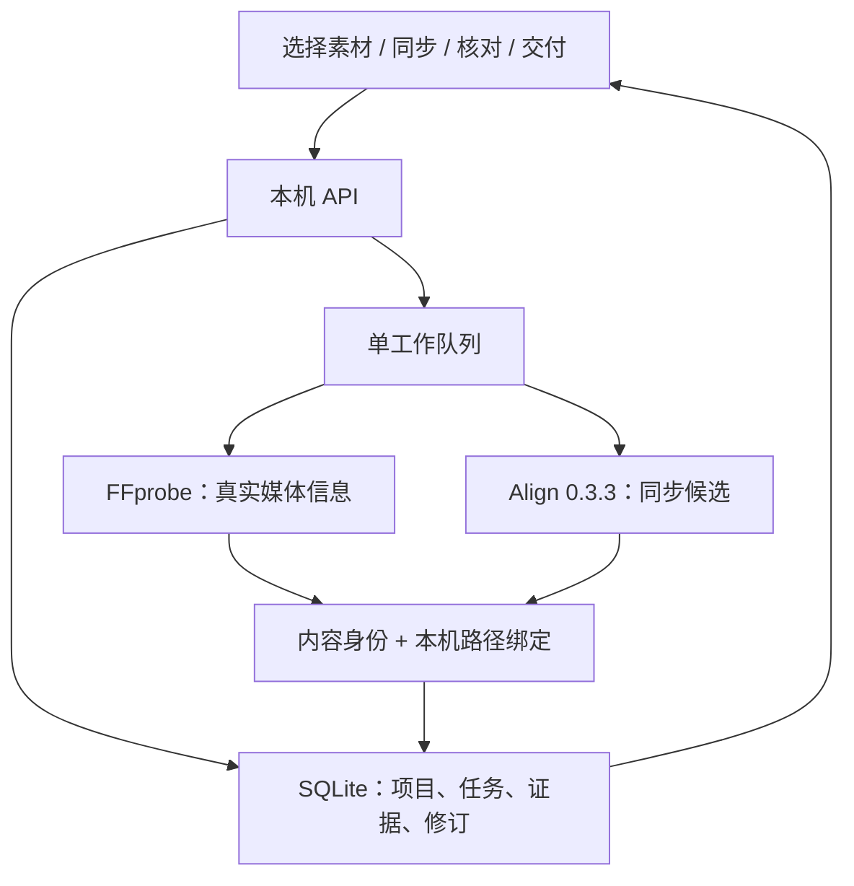
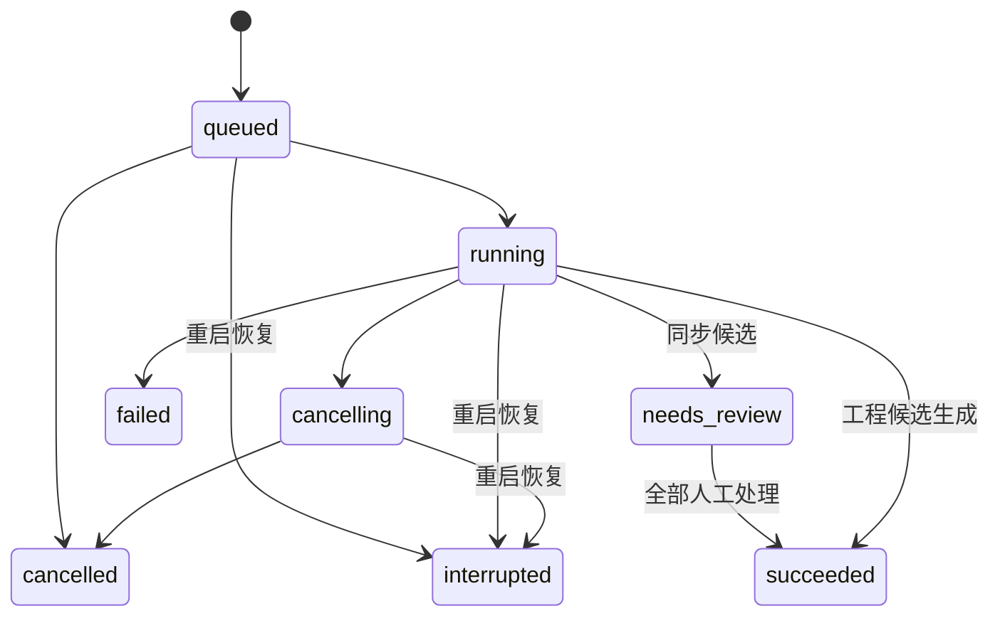

# Frameflow 最小架构

## 1. 决策

本轮不重写同步 DSP。采用 **Align v0.3.3 外部 CLI + FFprobe/FFmpeg + Python 本机任务层 + SQLite + 简洁浏览器界面**。

重计算由现成 Rust/媒体工具完成；Python 只管理身份、任务、核对和交付适配。浏览器界面为原生 HTML/CSS/JS，不要求 Node 前端构建、桌面 WebView 工具链、后台云服务或 AI Key。以后打包桌面壳不能复制第二套任务状态机。

## 2. 先复用的调查结论

调查日期：2026-11-17。事实来源与选择集中在此，不另建重复调研文档。

| 候选 | 可复用部分 | 决策与边界 |
| --- | --- | --- |
| [FFmpeg / ffprobe](https://ffmpeg.org/ffprobe.html) | 真实流、容器、帧率、时间码、音轨；后续代理和纠正副本 | 直接使用 CLI；许可证取决于实际 build，不能一概称 LGPL。 |
| [Align v0.3.3](https://github.com/FedyaLight/align/tree/v0.3.3) | 波形/时间码/连续录制证据、同步组、映射、导出；已有 CLI/MCP | 首个外部引擎。GPL-3.0-only，当前不复制或捆绑其代码。固定源码 fdf3e56845e5003b9f52c1c65d750497d607a4b5。 |
| [audalign](https://github.com/benfmiller/audalign) | MIT 音频指纹、相关与精调 | 保留为对照候选。相关算法会返回最佳候选，必须另做拒配与歧义判断；本轮没有接入第二套引擎。 |
| [OpenTimelineIO](https://opentimelineio.readthedocs.io/en/latest/) | 时间、片段、轨道、交换适配 | 作为交付候选；并不保证各 NLE 原生 multicam 语义。初版通过 Align 使用其导出能力，没有再做完整 OTIO 框架。 |
| [Syncaila](https://syncaila.com/) | 现成 Windows/macOS 同步与 NLE 交换工作流 | 适合作为后续真实素材对照，未确认公开稳定的可嵌入 SDK。 |
| [PluralEyes](https://www.maxon.net/en/article/pluraleyes-enters-limited-maintenance-mode) | 既有商业同步流程参考 | 已进入有限维护，不作为新产品底座。 |
| [Align MCP](https://github.com/FedyaLight/align/tree/v0.3.3/crates/align-mcp) | 已有 inspect/sync/export 工具封装 | 应用内部直接调用 CLI 更简单，不额外搭一层 MCP。 |
| [Windows Job Objects](https://learn.microsoft.com/en-us/windows/win32/procthread/job-objects)、[pywin32](https://github.com/mhammond/pywin32)、[psutil](https://psutil.readthedocs.io/en/latest/) | 原生进程树生命周期、暂停创建与恢复 | 仅 Windows 安装这两个成熟依赖；先将暂停的进程加入 kill-on-close Job Object 再恢复，避免父进程先退出后取消失效。 |
| MirrorOrder 的 vendor / 底层模块 | 时间基、取消竞争、原子缓存、Range 和 FCPXML 失败案例 | 只复用经验与验收语义；本轮没有复制旧代码。 |

### MirrorOrder 独立审计

基线为 [88e585e1](https://github.com/muee91/mirrororder/commit/88e585e1c5d44ad7698888a54683ab04a03596c3)。定向底层测试为 96 passed，但不代表真实素材或原生 NLE 验收。

- `vendor/multicam-audio-sync/scripts/sync.py`：可参考相关计算与偏移方向；`joint_fit({})` 会给无约束机位零偏移，不能移植为已同步结果。
- 同一机位按全局线性偏差拟合、无时间码按片长累计，会丢失真实拍摄间隙；不能覆盖局部重置与分段错误。
- `media_reader.py`、取消测试、HTTP Range 与 `timebase.py` 的边界有价值；旧接口与全局注册方式不照搬。
- `media_identity.py` 的首尾采样身份适合作为临时指纹，不作为完整内容证明；本轮使用完整 SHA256。
- `MulticamSyncTimeline.tsx` 是静态展示，没有实际连续播放核对；新界面从媒体播放与人工起点修正开始。
- `nle_delivery` 的 FCPXML multicam 元素与失败案例值得后续参考，但耦合旧输入对象，且结构测试不能充当软件实机验收。

## 3. 数据与执行

项目的 roots 属于**本机配置**。`assets` 保存内容身份和媒体事实；`bindings` 保存绝对路径与文件签名，禁止写入共享清单。完整哈希期间及分析后检查源变化；同内容副本仅分析一次，同名异内容保持独立。

本机变更检测统一基于文件句柄：Windows 使用原生 `FILE_BASIC_INFO.ChangeTime`，POSIX 使用 `fstat` 的 ctime，并保留设备、inode、大小和修改时间。哈希完成时的私有签名在入库前再次核对，避免旧身份绑定新内容；播放 Range 仅核对元数据，不重复读取整段原片。文件系统无法提供有效签名或旧签名不兼容时明确要求重扫。

`jobs` 保存 immutable attempt 的输入快照和当前状态；`events` 是有序追加事件；`results` 保存最近成功产生的候选与 revision；`reviews` 追加人工理由与前后值。人工修订不写回引擎原始 JSON，导出时从指定修订构造单独派生输入。

任务状态：

同步成功到 `needs_review`；`succeeded` 只表示本任务计算/人工处理结束，**不表示目标 NLE 导入通过**。失败/取消不覆盖上次结果，重试新建 attempt。单工作区 OS 文件锁防止两个服务互相将活任务标记中断；每项目唯一 active task 由 SQLite 唯一索引保护。

`heartbeat_at` 仅说明 worker 仍在服务；`progress_at` 只有真实阶段、计数、当前文件或任务变化时推进。静默并不等于失败，界面报告无新进展时长。对超时、工具缺失、损坏媒体、源变化、版本不兼容、取消等使用稳定原因码。

子进程不使用 shell；POSIX 使用独立进程组，Windows 使用 Job Object。有限输出、取消轮询、deadline、终止后回收属于同一执行边界；Windows 隔离或恢复失败时不启动媒体处理。成功结果在检查取消的同一 SQLite 事务中发布。只能清理本 attempt 自己创建的临时目录。重启恢复不是断点续算；崩溃后的候选必须重试，不能静默“补成功”。

## 4. Align 适配契约

[上游 CLI](https://github.com/FedyaLight/align/blob/v0.3.3/crates/align-cli/src/main.rs) 的 stdout 是终态 JSON，stderr 是 `inspect/fingerprint/match/refine/solve/export done/total filename`。没有稳定 JSON schemaVersion，也没有定时 heartbeat，所以锁定 0.3.3 并将业务进度与父进程心跳分离。阶段内 total 可能变化，不能拼造总体百分比。

上游 ClipID 来自路径/时长，不可跨设备共享。适配器以导入路径对应本机完整内容身份，不能把引擎 ID 暴露为产品素材身份。

`mapping.points` 是源时间到组时间的有理数映射。统一语义为 `group_time = offset + rate × source_time`，仅当全部点符合线性映射才显示该简式。分段非线性点原样保留，标记阻断；不能只取首尾偷换成整体错位。

默认上游导出会排序放置 unmatched。Frameflow 必须使用 `--unmatched remove`，同时保留自己的待处理/排除清单。只含时间码或连续录制证据仍是候选。独立同步组没有共同原点，不自动拼接为一条可信母版。

CLI 当前不暴露可靠优雅取消 checkpoint；Frameflow 用进程组退出+丢弃临时结果实现安全取消。上游缓存复用不等于 Frameflow 断点恢复。

## 5. 播放与交付

浏览器通过绑定的 media ID 读取本机原始文件，支持 HTTP Range；没有任意文件路径读取入口。公共时间轴按 `(group_time-offset)/rate` 定位，选择一路监听以免多路声音叠加。原始编码不支持时报告错误，不能用空播放器当已核对。

本轮实验性 FCPXML 复用 Align 导出，含多轨序列及 multicam/mc-angle/mc-clip 结构候选，保存人工偏移、明确排除项，拒绝非单位速率、非线性映射、多组拼接和未核对素材。导出也运行在同一可观察队列；结果校验必须为本任务目录内普通文件。每个 approved 片段从当前已验证的 media ID 绑定取得路径，替换导出副本中的旧 raw URL，完成前再次校验同一文件，避免失败重扫后的旧路径引用。本机 XML 可含媒体链接，但不提交到公开仓库；共享 manifest 使用字段白名单，不包含本机链接或原始 stderr。

| 目标 | 官方/现成能力与下一项验收 |
| --- | --- |
| [Resolve 原生协作](https://www.blackmagicdesign.com/products/davinciresolve/collaboration)与[官方 21.1 发布说明](https://www.blackmagicdesign.com/media/partial/release/20260908-03) | 多轨交换与原生 multicam 分开。官方已提供 AI 助手集成并扩展脚本能力；优先验证目标安装的原生 multicam 脚本入口与官方 MCP。具体方法和选项以安装内 Developer/Scripting 文档与运行时为准，不能照搬旧“API 永不支持”结论。版本、Studio/Free、Mac App Store 来源分别验证。 |
| [Premiere](https://helpx.adobe.com/premiere-pro/using/create-multi-camera-source-sequence.html) | 检查真正的 Multi-Camera Source Sequence，源监视器/时间线切换、独立录音与全部通道；XML 平铺轨道不是验收。 |
| [Final Cut Pro XML](https://developer.apple.com/documentation/professional-video-applications/fcpxml-reference) | 原生结构需要 media/multicam/mc-angle 与 mc-clip/mc-source；DTD/结构验证后仍需实际 Angle Editor、切换、保存重开。 |
| 国内剪映专业版 | 尚未核实公开稳定官方桌面工程 SDK/导入约定。不能将国际 CapCut 或私有 draft 生成器当成国内 Windows/macOS 都已支持。保留独立实验适配与版本验收。 |

后续 AI Provider 使用独立分析任务，输入媒体 ID 与同步修订，输出证据、Provider/模型版本、耗时和来源范围。人工修正是第一方事实，AI 不得静默覆盖。团队同步以后只共享上述事实与修订，本机 bindings 永不进入团队真相源。
